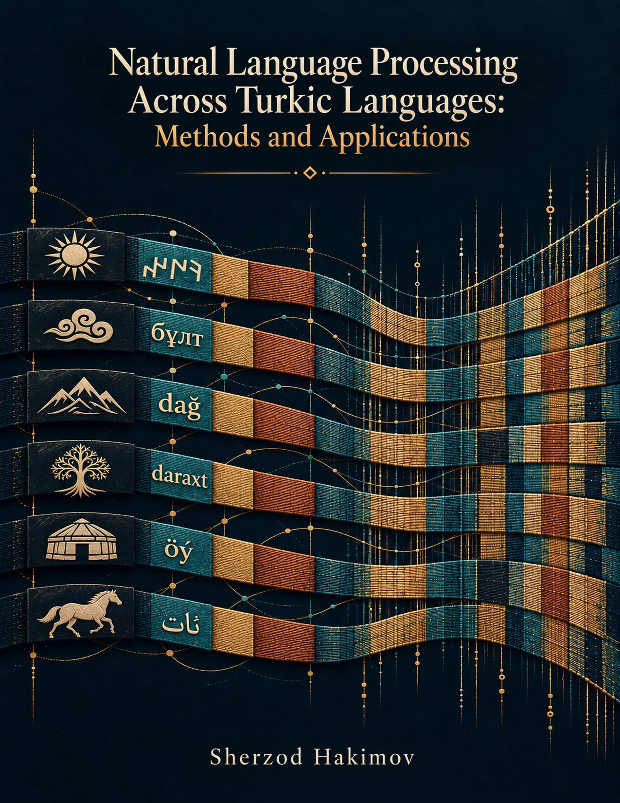

# Natural Language Processing Across Turkic Languages: Methods and Applications

Quarto sources for *Natural Language Processing Across Turkic Languages: Methods and Applications*, by Sherzod Hakimov. Draft version **0.1.0 (2026)**

<p align="center">
  <a href="Natural-Language-Processing-Across-Turkic-Languages--Methods-and-Applications.pdf"></a>
</p>

## Download the book

- **PDF:** [Natural-Language-Processing-Across-Turkic-Languages--Methods-and-Applications.pdf](Natural-Language-Processing-Across-Turkic-Languages--Methods-and-Applications.pdf) (letter size, 353 pages)
- **EPUB:** [Natural-Language-Processing-Across-Turkic-Languages--Methods-and-Applications.epub](Natural-Language-Processing-Across-Turkic-Languages--Methods-and-Applications.epub) (for e-readers)
- **DOI:** [10.5281/zenodo.23324599](https://doi.org/10.5281/zenodo.23324599)

## Read and study

The seventeen chapters connect linguistic structure and writing systems with corpora, task models, language models, evaluation and community-led development. Start with the [preface](preface.qmd) for reading routes. Each chapter includes learning objectives, a practical-work brief, an execution status and a closing synthesis.

Use the [exercise index](exercises/README.md) for worked notebooks and extensions. Recorded outputs document particular runs; rendering does not rerun model training. Keep dataset releases, source groups and test splits intact when extending an exercise.

## Repository layout

| Path | Contents |
|---|---|
| `index.qmd`, `preface.qmd`, `book-info.qmd`, `chapters/` | Book text (17 chapters and appendices A–D) |
| `references.bib` | Bibliography |
| `exercises/` | 92 exercise notebooks with worked solutions; see its README |
| `code/` | Chapter code (`chNN-*/`) and shared helpers and checks (`common/`) |
| `tables/`, `figures/` | One folder per table or figure: source data (`data.csv`), generator and output |
| `experiments/` | Data collection, measured results and recorded exercise outputs behind the book's numbers; see its README |
| `scripts/` | Render scripts, table and figure helpers, publication checks |
| `_quarto.yml`, `filters/`, `includes/`, `fonts/`, `images/` | Quarto configuration, Lua filters, LaTeX includes, bundled fonts and images |

## Build

Install Quarto and a working LuaLaTeX/TeX distribution. The PDF uses the bundled DejaVu fonts. From any working directory, invoke a render script by its path:

```sh
./scripts/render-all.sh
# Or: scripts/render-html.sh, scripts/render-pdf.sh, scripts/render-epub.sh
```

Outputs are written to `_book/`. All scripts preserve other formats with `--no-clean`; use a fresh source copy for a clean release build so stale artifacts cannot be mistaken for current output. Rendering uses checked-in experiment outputs; rerunning experiments requires their own documented environments and inputs.

## Licences

- **Text and figures:** [CC BY-SA 4.0](https://creativecommons.org/licenses/by-sa/4.0/) (`LICENSE`), unless otherwise noted.
- **Program code:** [Apache License 2.0](https://www.apache.org/licenses/LICENSE-2.0) (`code/LICENSE`). This covers `code/`, `scripts/`, `filters/`, and the Python scripts and notebook code in `exercises/`, `experiments/` and `tables/`.
- **Third-party data and models** keep their own licences. Examples are the UD treebanks, FLORES-200, Belebele, KazNERD, the Apertium transducers (GPL-3.0) and the NLLB weights (CC BY-NC 4.0). Each experiment README and manifest records which licence applies. UD Turkish-IMST (CC BY-NC-SA 4.0) text is not redistributed; see `experiments/empirical-2026-10/imst_text.py`.

